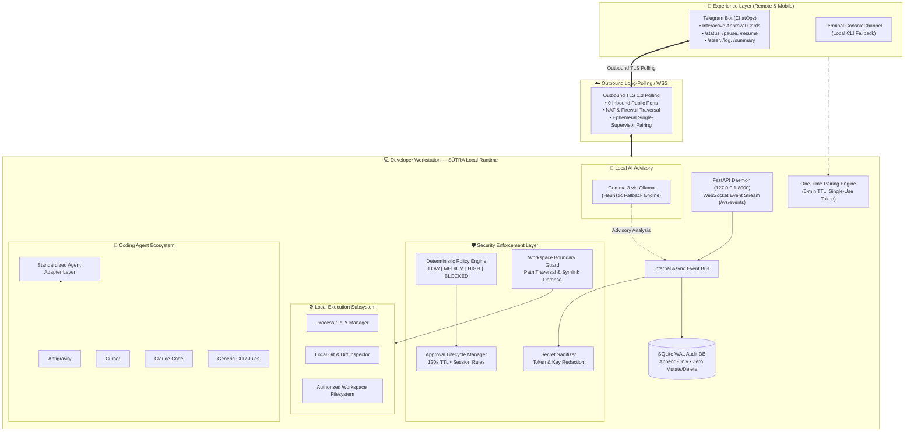

# SŪTRA (सूत्र)

<div align="center">

```
  ____   _   _  _____  ____      _    
 / ___| | | | ||_   _||  _ \    / \   
 \___ \ | | | |  | |  | |_) |  / _ \  
  ___) || |_| |  | |  |  _ <  / ___ \ 
 |____/  \___/   |_|  |_| \_\/_/   \_\
```

**Supervise Coding Agents Remotely • Secure Execution Locally • Keep Moving**

[](https://www.python.org/downloads/)
[](https://fastapi.tiangolo.com)
[](https://vitejs.dev)
[](https://github.com/Sayan-Mukherjee99/HOF)
[](LICENSE)

*Control remotely → Execute locally → Stay secure → Keep moving*

---

### **AOT × HacktoberFest 26 Software Hackday**
**Problem Statement:** Open Innovation & Gemma  
**Theme:** Developer Productivity Tool  
**Team Name:** The Four Musketeers  
- **Subhadip Paul** (Team Lead) — [GitHub](https://github.com/subhadip-paul)
- **Sayan Mukherjee** — [GitHub](https://github.com/Sayan-Mukherjee99)
- **Aritra Bhattacherjee** — [GitHub](https://github.com/aritra-bhattacherjee)
- **Sourajit Jash** — [GitHub](https://github.com/sourajit-jash)

---

</div>

## 📌 Executive Summary

Autonomous coding agents (Antigravity, Cursor, Claude Code, Codex, Google Jules) are transforming software engineering. However, **developers remain tethered to their desks**. 

When a long-running agent pauses for permissions, approvals, or mid-flight guidance, progress halts until the developer returns to the machine. A single blocked terminal command can interrupt hours of momentum.

Existing workarounds force undesirable trade-offs:
- **Remote Desktop:** Broad access, but heavy, awkward, and latency-prone on mobile.
- **Cloud IDEs:** Relocates development state, tools, and credentials away from the local machine.
- **Waiting:** Simple, but leaves capable agents idling for hours.

**SŪTRA (सूत्र)** is an agent-agnostic remote control plane and security layer for autonomous coding agents. It gives developers mobile-first supervision over local agents via **Telegram** and an ambient **Holographic Web Dashboard** — while enforcing that all execution remains **sandboxed on the local workstation with zero inbound open ports**.

---

## 🏛️ Core Architectural Pillars

### 1. 📱 Remote Agent Control (Mobile-First ChatOps)
- Supervise autonomous coding agents directly from your mobile device via Telegram (and console fallback).
- Receive instant push alerts for permission requests with interactive inline approval cards: `[Allow once]`, `[Allow session]`, and `[Deny]`.
- Remotely `/pause`, `/resume`, `/stop`, or `/steer` agents mid-flight with context guidance without touching the workstation keyboard.

### 2. 🔒 Secure Outbound Control Plane (Zero Inbound Ports)
- Local SŪTRA runtime establishes an outbound-only connection via **Telegram Long-Polling** (`getUpdates`) and an internal WebSocket bus.
- **Zero inbound public ports, zero router port forwarding, zero ngrok tunnels, and zero public attack surface.**
- Operates securely across home networks, mobile hotspots, corporate NATs, and firewalled environments.

### 3. 🛡️ Deterministic Security & Sandboxing
- **Deterministic Policy Engine:** Every command passes through strict safety classification (`LOW`, `MEDIUM`, `HIGH`, `BLOCKED`).
- **Sandbox Boundary Enforcement:** Workspace operations are constrained to authorized directory trees. Hard-blocks path traversal (`..`), symlink realpath escapes (`os.path.realpath`), privilege escalations (`sudo`), catastrophic commands (`rm -rf`), and piped remote shells (`curl | sh`).
- **Secret Sanitizer:** Automatically redacts API keys (`sk-...`, `ghp_...`, `xoxb-...`, `AKIA...`), JWT tokens, private keys (`.pem`, `.key`, `id_rsa`), and `.env` pairs before entering logs, events, or mobile notifications.
- **Append-Only SQLite WAL Audit Table:** Immutable audit log operating under SQLite WAL mode (`PRAGMA journal_mode=WAL;`). Zero `UPDATE` or `DELETE` SQL queries exist in the codebase.

### 4. 🎛️ Unified Agent Operations
- One standardized control plane for **Antigravity**, **Cursor**, **Claude Code**, **Codex**, **Google Jules**, and **Generic CLI** agents.
- Standardized Agent Adapter layer normalizes events, lifecycle states, and telemetry.
- Integrates local Git workflows, MCP servers, and terminal PTY processes into a unified supervisory stream.

---

## 🏗️ System Architecture & Workflow



---

## 🌌 Holographic Web Dashboard

In addition to mobile Telegram ChatOps, SŪTRA includes a state-of-the-art **Holographic Core Web Dashboard** (`/frontend`) built with Vite, React 19, TypeScript, and Vanilla CSS:

- **Ambient DataRain Particle Canvas:** Ambient dual-canvas particle rain animation (inspired by 21st.dev `@anark17r/data-rain`) with bloom filtration, vortex physics, and mouse deflection.
- **Sub-Pixel Grid & Multi-Layered Aura:** Deep obsidian theme (`#030305`) with 48px sub-pixel grid mesh and iridescent cyan/fuchsia/amber lighting.
- **Silky Animated Scroll:** Quartic ease-out scroll physics (`scrollToConsole`) with holographic perimeter glow pulse upon arriving at the console.
- **4 Real-Time Interactive Consoles:**
  1. **Runtime / Live Session:** Real-time agent status dot, elapsed timer, Pause/Resume/Stop controls, live event timeline, flat-panel Geist Mono log viewer with auto-scroll and jump-to-latest button, 120-second countdown pending approval card, and keyboard shortcuts (`A` / `S` / `D`).
  2. **Device Pairing:** Live supervisor pairing status, 6-character code generator with a 5-minute countdown clock, clipboard copy pill, and one-click revocation.
  3. **Audit Log:** Paginated append-only audit trail with risk level badges, timestamp formatting, command payload preview, and decision filtering.
  4. **Policy Engine:** Live command simulator to test commands against SŪTRA's deterministic risk engine in real time.

---

## ⚡ Quickstart & Installation

### 1. Prerequisites
- **Python 3.11+**
- **Node.js 18+** & `npm`
- **Make** (optional, for automation commands)
- *(Optional)* **Ollama** with `gemma3:4b` for AI advisory summaries

### 2. One-Step Installation
```bash
# Clone the repository
git clone https://github.com/Sayan-Mukherjee99/HOF.git
cd HOF

# Run automated setup (creates .venv, installs backend & frontend dependencies)
make install
```

Or manually:
```bash
# Backend setup
python3 -m venv .venv
source .venv/bin/activate
pip install -r backend/requirements.txt
pip install -e backend

# Frontend setup
cd frontend
npm install
cd ..
```

### 3. Environment Configuration
Copy the configuration template:
```bash
cp .env.example .env
```

Key configuration variables:
| Variable | Description | Default |
| :--- | :--- | :--- |
| `HOST` | Backend bind address | `127.0.0.1` |
| `PORT` | Backend server port | `8000` |
| `WORKSPACE_ROOT` | Allowed workspace directory boundary | `.` |
| `DATABASE_PATH` | SQLite WAL audit log file path | `sutra_audit.db` |
| `CORS_ORIGIN` | Allowed dashboard Vite frontend origin | `http://localhost:5173` |
| `BOT_TOKEN` | Telegram Bot token *(optional; falls back to terminal CLI if empty)* | `""` |
| `OLLAMA_URL` | Local Ollama instance URL | `http://localhost:11434` |
| `OLLAMA_MODEL` | Advisory model name | `gemma3:4b` |

---

## 🤖 Telegram Bot Setup (Mobile ChatOps)

To supervise your agent from your phone via Telegram:

1. **Create your Bot with BotFather:**
   - Open Telegram and message [@BotFather](https://t.me/BotFather).
   - Send `/newbot`.
   - Enter a display name (e.g. `Sutra Supervisor`) and a username ending in `bot` (e.g. `my_sutra_agent_bot`).
   - Copy the HTTP API token provided by BotFather (e.g. `7123456789:ABCdefGhIJKlmNoPQRsTUVwxyZ`).

2. **Add Token to `.env`:**
   ```bash
   BOT_TOKEN=7123456789:ABCdefGhIJKlmNoPQRsTUVwxyZ
   ```

3. **Pair Your Phone with Single-Supervisor Security:**
   - Generate a fresh pairing code on your workstation:
     ```bash
     python -m sutra pair
     ```
     ```text
     ======================================================
     🔑 SŪTRA ONE-TIME PAIRING CODE: 8F2A1C
     • Validity: 5 minutes (single use)
     • In Telegram, send to your bot: /pair 8F2A1C
     ======================================================
     ```
   - In Telegram, message your bot:
     ```text
     /pair 8F2A1C
     ```
   - The bot replies: `✅ Successfully paired with SŪTRA!`.
   - **Strict Isolation:** Any unauthorized messages from other chat IDs are dropped with zero response.

---

## 🏃 Running SŪTRA

### Start the Local Control Plane Daemon
```bash
make dev-backend
# Or: PYTHONPATH=backend .venv/bin/uvicorn sutra.main:app --host 127.0.0.1 --port 8000 --reload
```

### Start the Holographic Dashboard
```bash
make dev-frontend
# Or: cd frontend && npm run dev
```
Open **`http://localhost:5173`** to access the dashboard.

---

## ⏱️ 2-Minute Demo Simulation

Run the automated agent task simulator:
```bash
python -m sutra.seed
```

### Simulation Lifecycle:
1. **LOW Risk Command (`ls`)**:
   - Agent indexes repository.
   - Classification: `LOW` (read-only command within workspace).
   - **Auto-approved** instantly and logged to SQLite audit log.
2. **MEDIUM Risk Command (`git add backend/parser.py`)**:
   - Agent stages modified code.
   - Classification: `MEDIUM` (write operation within workspace).
   - Telegram sends an interactive approval card: `[ Allow once ]` `[ Allow session ]` `[ Deny ]`.
   - Tap **Allow once** (or press `A` on the web dashboard).
3. **BLOCKED Risk Command (`cat ../../.env`)**:
   - Agent attempts path traversal and credential access.
   - Classification: `BLOCKED`.
   - **Auto-denied** immediately. Blocked from execution, reported to audit log, and prohibited from running.
4. **HIGH Risk Command (`git push origin main`)**:
   - Agent attempts remote repository push.
   - Classification: `HIGH` (network / external synchronization).
   - Approval card displayed: `[ Allow once ]` `[ Deny ]` (*"Allow session" is strictly disabled for HIGH risk*).
   - Tap **Allow once** to complete the session.
5. All actions, timestamps, actors, and outcomes are permanently written to `sutra_audit.db`.

---

## 💬 Telegram Command Reference

| Command | Action | Security Behavior |
| :--- | :--- | :--- |
| `/status` | View agent state, active task, and pairing info | Paired chat only |
| `/pause` | Temporarily pause agent execution | Paired chat only |
| `/resume` | Resume paused agent task | Paired chat only |
| `/stop` | Terminate active task immediately | Paired chat only |
| `/steer <guidance>` | Provide mid-flight context guidance to agent | Sanitized before dispatch |
| `/log` | Fetch last 20 sanitized audit log entries | Redacts all keys/tokens |
| `/summary` | Advisory progress analysis (Gemma 3 / heuristic) | Read-only advisory |
| `/unpair` | Revoke active supervisor pairing | Invalidates session |
| `/help` | Display command list | Paired chat only |

---

## 🛡️ Deterministic Policy Matrix

| Risk Level | Policy Rule | Examples | Approval Requirement |
| :---: | :--- | :--- | :---: |
| **LOW** | Read-only inspection within workspace | `ls`, `git status`, `cat src/App.tsx`, `grep`, `pwd` | Auto-approved |
| **MEDIUM** | Safe workspace modifications | `git add`, `npm run build`, `pytest`, `touch`, `mkdir` | Interactive approval (`Allow once` or `Allow session`) |
| **HIGH** | Outbound sync, dependencies, unknown tools | `git push`, `npm install <pkg>`, unknown binaries | Interactive approval (`Allow once` only; no session bypass) |
| **BLOCKED** | Traversal, symlink escapes, secrets, dangerous ops | `cat ../.env`, `sudo`, `rm -rf /`, `curl \| sh`, `*.pem`, `id_rsa` | **Strict Auto-Deny** |

---

## 🗺️ Roadmap & Phase Overview

```
Phase 01: Foundation [DONE]
├── Local Runtime Daemon (FastAPI + Uvicorn)
├── One-Time Single-Supervisor Pairing Engine
├── SQLite WAL Append-Only Audit Logging
└── Health & Diagnostics APIs

Phase 02: Secure Remote Control [DONE]
├── Authenticated Outbound TLS Polling
├── Telegram ChatOps (Inline Approvals)
├── Deterministic Policy Engine & Sandboxing
├── Secret Sanitizer (Tokens, Keys, Env)
└── Holographic Web Dashboard (DataRain Animation + Live HUD)

Phase 03: Intelligent Operations [CURRENT]
├── Multi-Agent Adapter Layer (Antigravity, Cursor, Claude Code, Jules)
├── Local Gemma 3 Advisory via Ollama
├── Real-Time WebSocket Telemetry
└── Loop & Plan Drift Detection

Phase 04: Ecosystem & Enterprise Hardening [FUTURE]
├── Discord & Slack Integration Channels
├── Web PWA for Standalone Mobile Experience
├── PyPI Package: `pip install sutra`
├── Multi-Workstation Fleet Management
└── Team Role-Based Access Control (RBAC)
```

---

## 🧪 Test Suite

Run the full automated test suite:
```bash
make test
```
Or directly via pytest:
```bash
.venv/bin/pytest backend/tests -v
```

All **28 unit and integration tests** verify:
- ✅ Strict command risk classification and default-to-HIGH policy enforcement
- ✅ Path traversal and symlink realpath escape prevention
- ✅ Secret redaction across logs, events, and Telegram payloads
- ✅ SQLite WAL mode and append-only database invariants
- ✅ Pairing lifecycle and zero-response silence for unauthorized users
- ✅ 120-second approval expiration and duplicate decision rejection
- ✅ WebSocket event streaming and REST lifecycle endpoints

---

## 👥 The Team — The Four Musketeers

Developed during **AOT × HacktoberFest 26 Software Hackday**:

- **Subhadip Paul** (Team Lead) — [GitHub](https://github.com/subhadip-paul)
- **Sayan Mukherjee** — [GitHub](https://github.com/Sayan-Mukherjee99)
- **Aritra Bhattacherjee** — [GitHub](https://github.com/aritra-bhattacherjee)
- **Sourajit Jash** — [GitHub](https://github.com/sourajit-jash)

---

## 📄 License

This project is licensed under the [MIT License](LICENSE).
